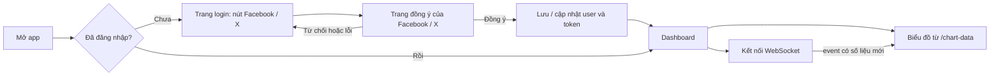
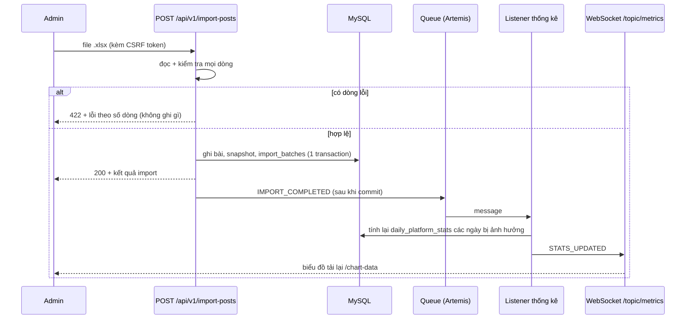

# Phân tích yêu cầu — Social Analytics Dashboard

## 1. Tổng quan

Ứng dụng web giúp admin tổng hợp và theo dõi lượng tương tác (likes, shares, comments, followers) của các bài viết trên Facebook và Twitter (X). Số liệu được cập nhật định kỳ bởi job chạy nền (gọi API giả lập), nhập thêm từ file Excel, tổng hợp theo ngày và hiển thị bằng biểu đồ cập nhật realtime.

Công nghệ: Java 21, Spring Boot 4.1 (đề ghi 3.x, xem [cau-hoi-lam-ro.md](cau-hoi-lam-ro.md), mục "Cần báo mentor"), Spring Data JPA + MySQL 8.4 + Flyway, Spring Security + OAuth2 Login, ActiveMQ Artemis (JMS), WebSocket STOMP, Spring-WS, Apache POI, Thymeleaf + Chart.js, Maven.

Tài liệu liên quan:
- [01-thiet-ke-csdl.md](01-thiet-ke-csdl.md): bảng hiện có và lộ trình schema.
- [02-thiet-ke-api.md](02-thiet-ke-api.md): API đã làm và API dự kiến, format lỗi.
- [03-kien-truc.md](03-kien-truc.md): package, bảo mật, job, JMS, WebSocket, SOAP.
- [cau-hoi-lam-ro.md](cau-hoi-lam-ro.md): các điểm đề chưa rõ (Q1–Q12): Q1, Q2, Q5, Q12 đã chốt, các câu còn lại đang chờ trả lời.

Quy ước: **Đề yêu cầu** là điều đề bài ghi; **Đề xuất** là lựa chọn của nhóm khi đề không nói, có thể đổi theo câu trả lời ở `cau-hoi-lam-ro.md`.

## 2. Tác nhân

| Tác nhân | Làm được gì | Xác thực |
|---|---|---|
| Khách | Chỉ thấy trang đăng nhập | Không |
| User (`USER`) | Xem dashboard, biểu đồ, "Last updated time", danh sách bài và snapshot, xuất Excel | OAuth2 Login (Facebook/X), session |
| Admin (`ADMIN`) | Mọi quyền của user, thêm: tạo/sửa/xóa bài và snapshot, import Excel, chạy job thủ công | Như user; là admin nếu có trong danh sách cấu hình (đã chốt, Q1) |
| Job nền | Mỗi giờ cập nhật số liệu từ API giả lập | Không qua HTTP |
| Hệ thống SOAP | Cung cấp tỷ giá (dịch vụ giả lập) | Không (dịch vụ giả lập, chỉ đọc) |

## 3. Tính năng

| Mã | Tính năng | Giai đoạn của đề | Issue | Trạng thái |
|---|---|---|---|---|
| F1 | Project nền: cấu trúc lớp, cấu hình, logging, Swagger | Khởi tạo project | #2 | PR #1 |
| F2 | Entity `User`, `Post`, `SocialMetric`, schema | Khởi tạo project | #3 | PR #19 |
| F3 | API CRUD `/posts`, `/metrics` | Khởi tạo project | #4 | PR #20 |
| F4 | Unit test Service/Controller, `@DataJpaTest` | Unit Test + Import/Export Excel | #5 | Chưa làm |
| F5 | Import bài viết từ Excel (`/import-posts`) | Unit Test + Import/Export Excel | #6 | Chưa làm |
| F6 | Xuất báo cáo Excel (`/export-report`) | Unit Test + Import/Export Excel | #7 | Chưa làm |
| F7 | Spring Security, CSRF | Bảo mật & CSRF + Social Login | #8 | Chưa làm |
| F8 | Đăng nhập Facebook/X, lưu user và token | Bảo mật & CSRF + Social Login | #9 | Chưa làm |
| F9 | Job `updateSocialMetricsJob` mỗi giờ, đa luồng | Background Job & MultiThread | #10 | Chưa làm |
| F10 | Dashboard, "Last updated time", chạy job thủ công | Background Job & MultiThread | #11 | Chưa làm |
| F11 | JMS: `IMPORT_COMPLETED` → tính lại thống kê, retry, DLQ | JMS & Queue Handling | #12 | Chưa làm |
| F12 | WebSocket STOMP, `/chart-data` | WebSocket + Chart Visualization | #13 | Chưa làm |
| F13 | Biểu đồ Chart.js cập nhật realtime | WebSocket + Chart Visualization | #14 | Chưa làm |
| F14 | Gọi SOAP (tỷ giá giả lập) bằng Spring-WS | Spring WebService + Reflection + Tổng kết | #15 | Chưa làm |
| F15 | Import/export generic bằng Reflection | Spring WebService + Reflection + Tổng kết | #16 | Chưa làm |
| F16 | Integration test end-to-end, đóng gói, demo | Spring WebService + Reflection + Tổng kết | #17 | Chưa làm |
| — | CI (GitHub Actions) | Không có trong đề | #18 | Chưa làm |

## 4. Đối chiếu đề bài

Mỗi mục "Thực hành" của đề phải có tính năng và issue tương ứng.

| Giai đoạn | Thực hành (theo đề) | Tính năng | Issue |
|---|---|---|---|
| Khởi tạo project | Tạo Spring Boot project (`social-analytics`) | F1 | #2 |
| | Tạo bảng & API CRUD cơ bản (`/posts`, `/metrics`) | F2, F3 | #3, #4 |
| | Thêm Swagger/OpenAPI | F1, F3 | #2, #4 |
| Unit Test + Import/Export Excel | Viết test cho `PostService`, `MetricService` | F4 | #5 |
| | API `/import-posts` (upload Excel → save DB) | F5 | #6 |
| | API `/export-report` (export Excel) | F6 | #7 |
| Bảo mật & CSRF + Social Login | Bật CSRF, thêm filter token vào form | F7 | #8 |
| | Login với Facebook & Twitter → redirect về dashboard | F8, F10 | #9, #11 |
| | Lưu token truy cập và thông tin user | F8 | #9 |
| Background Job & MultiThread | Tạo job `updateSocialMetricsJob` chạy mỗi 1 giờ | F9 | #10 |
| | Cập nhật metrics (mock API từ FB/TW) | F9 | #10 |
| | Thêm màn hình "Last updated time" | F10 | #11 |
| JMS & Queue Handling | Import Excel → publish message `IMPORT_COMPLETED` | F11 | #12 |
| | Listener nhận message → cập nhật thống kê tổng hợp (async) | F11 | #12 |
| WebSocket + Chart Visualization | Có dữ liệu mới (metrics update) → gửi WebSocket event | F12 | #13 |
| | Frontend nhận và update Chart.js | F13 | #14 |
| | API `/chart-data` trả dữ liệu tổng hợp | F12 | #13 |
| Spring WebService + Reflection + Tổng kết | Gọi 1 WebService mock (ví dụ: exchange rate API SOAP) | F14 | #15 |
| | Dùng Reflection để tự động xuất model thành Excel | F15 | #16 |
| | Viết Integration Test cuối cùng | F16 | #17 |
| | Đóng gói project, chạy end-to-end demo | F16 | #17 |

Các yêu cầu kỹ thuật ở bảng "Technical Requirements Summary" của đề (Retry/DLQ, `@Async` + `ThreadPoolTaskExecutor`, SLF4J + Logback, JUnit5 + Mockito + MockMvc, SockJS) nằm trong các issue tương ứng ở trên. "Dùng Reflection để map dữ liệu từ file Excel vào entity" (nội dung học của giai đoạn 2) làm ở #6, tổng quát hóa ở #16.

## 5. Use case

| Mã | Use case | Tác nhân | Tính năng |
|---|---|---|---|
| UC01 | Đăng nhập bằng Facebook hoặc X, về dashboard | Khách | F8 |
| UC02 | Đăng xuất | User | F8 |
| UC03 | Xem dashboard: "Last updated time", trạng thái lần chạy gần nhất, biểu đồ, tỷ giá | User | F10, F13, F14 |
| UC04 | Xem, lọc, tìm bài viết; xem snapshot theo khoảng thời gian | User | F3 |
| UC05 | Thêm, sửa, xóa bài viết và snapshot | Admin | F3 |
| UC06 | Import file Excel bài viết | Admin | F5, F11 |
| UC07 | Xuất báo cáo Excel | User | F6 |
| UC08 | Chạy job cập nhật số liệu thủ công | Admin | F10 |
| UC09 | Biểu đồ tự cập nhật khi có số liệu mới | User (đang mở dashboard) | F12, F13 |
| UC10 | Cập nhật số liệu mỗi giờ | Job nền | F9 |

## 6. Luồng chính

### 6.1. Đăng nhập và xem dashboard

1. Chưa đăng nhập mà vào trang nào cũng bị chuyển về `/login`; gọi API thì nhận 401 JSON.
2. Login thành công: lưu hoặc cập nhật `users` theo `(provider, provider_user_id)`, lưu token, role theo danh sách admin (Q1), rồi chuyển về dashboard (**đề yêu cầu**). Thất bại: về trang login kèm thông báo.

### 6.2. Import Excel → thống kê → biểu đồ

### 6.3. Job mỗi giờ

1. Đến giờ (cron đọc từ cấu hình, theo giờ Việt Nam), job tạo một dòng `metric_update_runs` trạng thái `RUNNING`. Lần chạy trước chưa xong thì bỏ qua lần này.
2. Lấy danh sách tài khoản `(platform, account_name)`, mỗi tài khoản là một tác vụ trên `ThreadPoolTaskExecutor`.
3. Mỗi tác vụ gọi API giả lập (không giữ transaction/connection DB khi chờ), rồi ghi snapshot của tài khoản đó trong một transaction ngắn. Lỗi ở một tài khoản chỉ được log và đếm, không làm dừng các tài khoản khác.
4. Hết các tác vụ: cập nhật dòng `metric_update_runs` (`SUCCEEDED`/`PARTIAL`/`FAILED`), gửi `METRICS_UPDATED` vào queue (đã chốt, Q5) và event WebSocket `JOB_FINISHED`.

## 7. Quy tắc nghiệp vụ

- **Thời gian** (đề xuất, đã áp dụng từ #3): DB lưu UTC (`DATETIME(6)`); "hôm nay", ranh giới ngày trong thống kê, biểu đồ, export và tên file đều tính theo `Asia/Ho_Chi_Minh` qua bean `Clock`. Không dùng múi giờ của JVM.
- **Bài viết**: định danh là `(platform, external_id)`, không đổi được sau khi tạo; trùng thì 409 (API) hoặc cập nhật (import, Q4).
- **Snapshot**: mỗi bài có tối đa một snapshot tại một thời điểm; số đếm không âm. Mọi snapshot của một lần chạy job hoặc một lần import dùng chung một `captured_at`.
- **Followers** là số của tài khoản, không phải của bài: tổng hợp lấy một giá trị cho mỗi tài khoản, không cộng theo bài (`01-thiet-ke-csdl.md`, quyết định 2).
- **Quyền** (đã chốt, Q1): ghi dữ liệu, import, chạy job chỉ `ADMIN`; xem và export cho mọi user đã đăng nhập.
- **Import** (đề xuất, Q3, Q4): tất cả hoặc không có gì; bài trùng thì cập nhật; tối đa 5MB, 5.000 dòng.
- **Thống kê** (đã chốt, Q5, Q12): tính lại sau import, sau mỗi lần chạy job và sau khi sửa/xóa qua API; tính lại từ dữ liệu gốc cho các ngày bị ảnh hưởng, không cộng dồn, nên xử lý trùng message vẫn đúng. Số của một ngày là tổng snapshot mới nhất của mỗi bài **tính đến hết ngày đó**, nên ngày thiếu snapshot không bị tụt về 0.
- **Ghi đồng thời** (đã áp dụng từ #4): sửa thì khóa dòng ngay lần đọc đầu; xóa là một câu `DELETE` kiểm tra số dòng; trùng khóa nghiệp vụ do ràng buộc UNIQUE chặn và trả 409.

## 8. Yêu cầu phi chức năng

- **Bảo mật** (đề yêu cầu CSRF + OAuth2 Login): CSRF bật cho mọi request thay đổi dữ liệu, kể cả API JSON gọi từ trình duyệt và upload multipart; token OAuth không log, không trả ra ngoài; Swagger chỉ ở profile `dev`; actuator chỉ mở `health`.
- **Cấu hình** qua biến môi trường, mẫu trong `.env.example` (đã có từ #2): DB, port, múi giờ; thêm dần client id/secret OAuth2, danh sách admin, broker, cron job, kích thước thread pool, URL SOAP.
- **Hiệu năng**: phân trang và lọc ở DB; biểu đồ đọc bảng tổng hợp; export dùng `SXSSFWorkbook` để không giữ cả file trong bộ nhớ; job không giữ connection DB khi chờ API.
- **Độ tin cậy**: cấu hình sai (cron, kích thước pool) thì app báo lỗi ngay lúc khởi động; message lỗi được thử lại có giới hạn rồi vào DLQ và được log.
- **Logging**: SLF4J + Logback (đã có); log lỗi kèm ngữ cảnh (tài khoản, nền tảng, batch, run) nhưng không kèm token.
- **Kiểm thử**: test trên MySQL thật (Testcontainers), không phụ thuộc thứ tự chạy; nhánh xử lý lỗi và trường hợp chạy đồng thời đều có test; JaCoCo để xem coverage (#5, #17).

## 9. Ngoài phạm vi

- Gọi API thật của Facebook/X để lấy số liệu (đề ghi "mock API").
- Gộp tài khoản Facebook và X của cùng một người.
- Chạy nhiều instance: session, khóa chống chạy chồng job và broker WebSocket đều trong bộ nhớ của một instance (xem `03-kien-truc.md`).
- ReactJS (đề cho chọn, chọn Thymeleaf, Q9).
