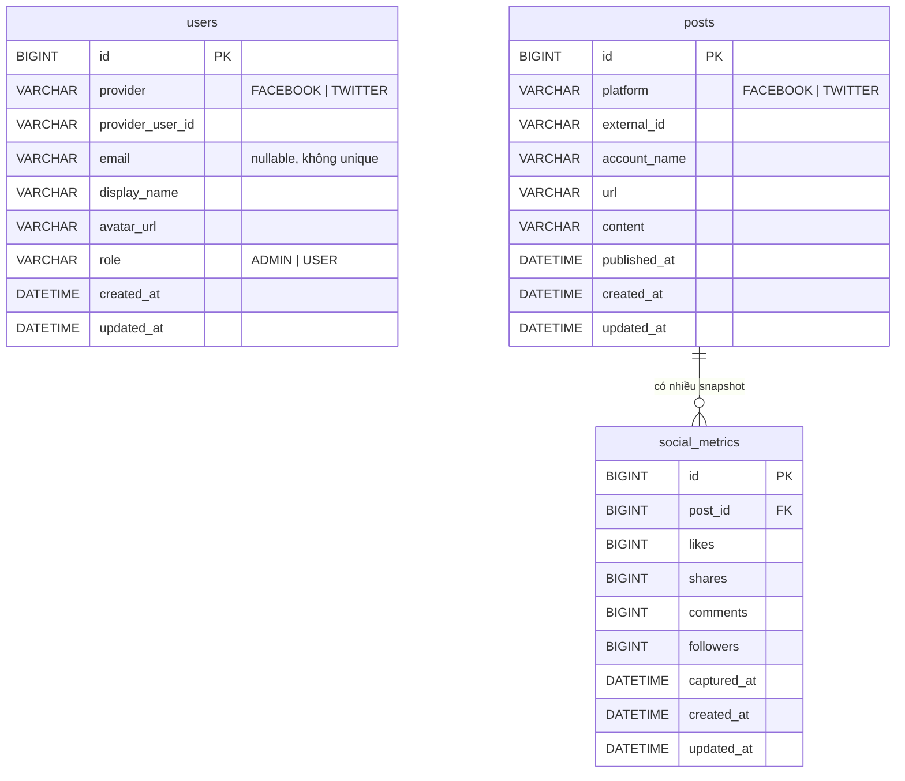
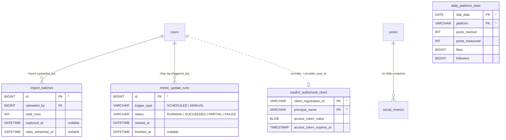

# Thiết kế cơ sở dữ liệu

Schema tạo bằng Flyway; Hibernate chỉ `validate`, không tự sửa schema ở bất kỳ profile nào.

- **Đã có** (issue #3, `src/main/resources/db/migration/V1__init_schema.sql`): `users`, `posts`, `social_metrics`. Đây là 3 entity mà giai đoạn "Khởi tạo project" của đề yêu cầu.
- **Dự kiến** (mục [Lộ trình schema](#lộ-trình-schema-dự-kiến)): các bảng mà những giai đoạn sau cần (lưu token đăng nhập, lịch sử chạy job, lịch sử import, thống kê tổng hợp). Mỗi bảng được thêm bằng một migration mới trong đúng issue dùng nó; không sửa file migration đã chạy.

## Sơ đồ hiện tại (V1)

## Bảng hiện có (V1)

### `users`

Người đăng nhập bằng Facebook/Twitter (OAuth2, làm ở #9).

| Cột | Kiểu | Ràng buộc | Ghi chú |
|---|---|---|---|
| `provider` | VARCHAR(20) | NOT NULL, CHECK `FACEBOOK`/`TWITTER` | enum `SocialPlatform` |
| `provider_user_id` | VARCHAR(100) | NOT NULL | id tài khoản phía provider |
| `email` | VARCHAR(255) | NULL | không unique, xem quyết định bên dưới |
| `display_name` | VARCHAR(100) | NOT NULL | |
| `avatar_url` | VARCHAR(1000) | NULL | |
| `role` | VARCHAR(20) | NOT NULL, mặc định `USER`, CHECK `ADMIN`/`USER` | enum `UserRole` |

- UNIQUE `uk_users_provider_user (provider, provider_user_id)`: một tài khoản mạng xã hội chỉ ứng với một user; login lần sau tìm theo cặp này.
- Access token của provider để #9 thêm bằng migration mới (V2), không làm ở đây.

### `posts`

Bài viết cần theo dõi, nhập tay qua API (#4) hoặc import Excel (#6).

| Cột | Kiểu | Ràng buộc | Ghi chú |
|---|---|---|---|
| `platform` | VARCHAR(20) | NOT NULL, CHECK `FACEBOOK`/`TWITTER` | enum `SocialPlatform` |
| `external_id` | VARCHAR(100) | NOT NULL | id bài viết trên nền tảng |
| `account_name` | VARCHAR(100) | NOT NULL | page/handle đăng bài; job #10 gom bài theo tài khoản |
| `url` | VARCHAR(1000) | NULL | |
| `content` | VARCHAR(5000) | NULL | DTO ở #4 giới hạn `@Size(max = 5000)` tương ứng |
| `published_at` | DATETIME(6) | NULL | |

- UNIQUE `uk_posts_platform_external_id (platform, external_id)`: khóa nghiệp vụ, dùng để nhận ra bài trùng khi import.
- INDEX `idx_posts_platform_account (platform, account_name)`: job cập nhật metrics lấy bài theo tài khoản.

### `social_metrics`

Snapshot số tương tác của một bài tại thời điểm `captured_at`. Mỗi lần job chạy (mỗi giờ) thêm một dòng, nhờ đó vẽ được biểu đồ theo thời gian (#13, #14).

| Cột | Kiểu | Ràng buộc | Ghi chú |
|---|---|---|---|
| `post_id` | BIGINT | NOT NULL, FK → `posts.id` `ON DELETE CASCADE` | |
| `likes`, `shares`, `comments`, `followers` | BIGINT | NOT NULL, mặc định 0, CHECK `>= 0` | |
| `captured_at` | DATETIME(6) | NOT NULL | thời điểm đo |

- UNIQUE `uk_social_metrics_post_captured (post_id, captured_at)`: không có hai snapshot cùng lúc cho một bài; index này cũng phục vụ FK và truy vấn "snapshot mới nhất của bài".
- INDEX `idx_social_metrics_captured_at (captured_at)`: lọc theo khoảng thời gian cho `/chart-data` và báo cáo.

Mọi bảng có `id` (BIGINT AUTO_INCREMENT), `created_at`, `updated_at` (DATETIME(6), NOT NULL).

## Quyết định thiết kế (V1)

1. **Giá trị cố định dùng enum, lưu theo tên (VARCHAR + CHECK) thay vì kiểu `ENUM` của MySQL.** Entity dùng `@Enumerated(STRING)` kèm `@JdbcTypeCode(SqlTypes.VARCHAR)` để khai báo rõ kiểu cột khớp với migration, không phụ thuộc vào kiểu mặc định Hibernate chọn cho enum trên MySQL. Thêm giá trị mới chỉ cần sửa CHECK bằng migration, không phải `ALTER` kiểu cột.
2. **`followers` nằm trong `social_metrics`.** Đề chỉ yêu cầu 3 entity `User`, `Post`, `SocialMetric` và nêu followers cùng nhóm với likes/shares. Mỗi snapshot lưu số follower của tài khoản đăng bài tại thời điểm đo, nên các bài cùng tài khoản đo cùng lúc sẽ lặp lại cùng một số. Khi tổng hợp followers theo tài khoản phải lấy một giá trị cho mỗi `(platform, account_name, captured_at)` (ví dụ `MAX`), không được cộng dồn theo bài. Nếu sau này cần lịch sử follower độc lập với bài viết thì tách bảng `social_accounts` bằng migration mới.
3. **`Post` không map `@OneToMany` tới metrics.** Một bài có thể tích lũy hàng nghìn snapshot (mỗi giờ một dòng); đọc qua `SocialMetricRepository` theo khoảng thời gian/phân trang. Không có `orphanRemoval`/`cascade` phía JPA nên thay đổi trên `Post` không thể vô tình xóa snapshot. Xóa bài thì DB tự xóa snapshot (`ON DELETE CASCADE`), vì snapshot không có ý nghĩa khi không còn bài.
4. **`email` không unique.** Twitter có thể không trả email, và một người có thể đăng nhập bằng cả Facebook lẫn Twitter với cùng email; mỗi tài khoản là một user riêng. Gộp tài khoản nằm ngoài phạm vi đề.
5. **Thời gian lưu UTC, "hôm nay" theo `Asia/Ho_Chi_Minh`.** JDBC ghi/đọc theo UTC (`hibernate.jdbc.time_zone=UTC`, `serverTimezone=UTC`). Bean `Clock` dùng múi giờ `app.time-zone` (mặc định `Asia/Ho_Chi_Minh`); code cần ngày hiện tại dùng `LocalDate.now(clock)`, không dùng múi giờ của JVM (UTC trong container). `created_at`/`updated_at` do Spring Data auditing điền từ cùng `Clock`, nên test cố định được thời gian.
6. **Seed dữ liệu chỉ ở profile `dev`.** `DataSeeder` (`@Profile("dev")`) thêm 4 bài mẫu và 7 ngày snapshot, bỏ qua nếu bảng `posts` đã có dữ liệu.

## Lưu ý cho các issue sau

- **Vi phạm UNIQUE, FK hay CHECK đều thành `DataIntegrityViolationException`** (Hibernate 7, test trong `PostRepositoryTests`/`SocialMetricRepositoryTests`). Handler ở #4 map lỗi này về 409, nhưng 409 chỉ đúng cho trường hợp trùng dữ liệu; số âm hay platform không hợp lệ là lỗi input, nên DTO ở #4/#6 phải chặn trước: số âm bằng `@PositiveOrZero` (422), platform lạ bị chặn ngay khi đọc JSON vì DTO dùng kiểu enum (400). CHECK chỉ là lớp bảo vệ cuối. Bảng mã lỗi đầy đủ ở `docs/02-thiet-ke-api.md`.
- **Collation `utf8mb4_0900_ai_ci`** không phân biệt hoa/thường và dấu: so sánh `account_name` hay tìm kiếm `content` sẽ coi `Thai` và `Thái` là bằng nhau.

## Lộ trình schema (dự kiến)

Phần này là **thiết kế, chưa có migration**. Số version (`V2`, `V3`, …) đặt khi làm, theo thứ tự issue được merge; tài liệu chỉ ghi "migration mới ở #N". Câu hỏi còn mở về các bảng này nằm ở [cau-hoi-lam-ro.md](cau-hoi-lam-ro.md) (Q…), phần nào phụ thuộc câu trả lời thì ghi rõ.

| Bảng | Issue thêm | Giai đoạn của đề cần nó | Vì sao cần bảng riêng |
|---|---|---|---|
| `oauth2_authorized_client` | #9 | Bảo mật & Social Login: "Lưu token truy cập và thông tin user" | Thông tin user đã ở `users`; token truy cập lưu theo schema chuẩn của Spring Security thay vì tự thêm cột vào `users` |
| `import_batches` | #6 | Unit Test + Import/Export Excel; JMS: "import Excel → publish `IMPORT_COMPLETED`" | Mỗi lần import có một id để message JMS tham chiếu, và lưu lại ai import, kết quả ra sao |
| `metric_update_runs` | #10 | Background Job: "Thêm màn hình Last updated time" | Lưu thời điểm và trạng thái từng lần chạy job (kể cả lần lỗi); `MAX(captured_at)` không cho biết lần chạy gần nhất có lỗi hay không |
| `daily_platform_stats` | #12 | JMS: "Listener nhận message → cập nhật thống kê tổng hợp"; WebSocket: "`/chart-data` trả dữ liệu tổng hợp" | Đề yêu cầu cập nhật thống kê tổng hợp bất đồng bộ, nên cần nơi lưu kết quả tổng hợp; biểu đồ đọc bảng nhỏ này thay vì quét toàn bộ snapshot |

Không thêm bảng cho: session đăng nhập (giữ trong bộ nhớ, chạy một instance, xem `docs/03-kien-truc.md`), tài khoản mạng xã hội được theo dõi (`social_accounts`, xem quyết định 2 ở trên: chỉ tách khi cần lịch sử follower độc lập với bài viết), tỷ giá SOAP (gọi khi cần, cache trong bộ nhớ).

### Sơ đồ sau khi đủ các bảng

Bảng có dấu `*` là dự kiến. `oauth2_authorized_client` không có FK tới `users` vì do Spring Security quản lý; hai bảng nối với nhau bằng `(client_registration_id, principal_name)` = `(provider, provider_user_id)` (viết thường/hoa khác nhau, xem bên dưới).

`daily_platform_stats` không có FK: nó là dữ liệu dẫn xuất, tính lại được hoàn toàn từ `posts` + `social_metrics`.

### `oauth2_authorized_client` (#9)

Đề xuất dùng `JdbcOAuth2AuthorizedClientService` của Spring Security, nên bảng theo đúng schema chuẩn đi kèm Spring Security (`oauth2-client-schema.sql`), viết lại cho MySQL. Danh sách cột dưới đây theo schema đó; **kiểm tra lại với bản Spring Security đang dùng khi làm #9**, vì service đọc/ghi đúng tên cột.

| Cột | Kiểu (MySQL) | Ghi chú |
|---|---|---|
| `client_registration_id` | VARCHAR(100), PK | `facebook` / `twitter` (id đăng ký client trong cấu hình) |
| `principal_name` | VARCHAR(200), PK | tên principal sau khi login, đề xuất là id tài khoản phía provider |
| `access_token_type` | VARCHAR(100) | `Bearer` |
| `access_token_value` | BLOB | token truy cập |
| `access_token_issued_at`, `access_token_expires_at` | TIMESTAMP | |
| `access_token_scopes` | VARCHAR(1000), NULL | |
| `refresh_token_value` | BLOB, NULL | Facebook không cấp refresh token theo luồng thường; X có thể cấp khi xin scope `offline.access` (kiểm tra khi làm #9) |
| `refresh_token_issued_at` | TIMESTAMP, NULL | |
| `created_at` | TIMESTAMP, mặc định thời điểm insert | |

- **Đề yêu cầu** lưu token truy cập. **Đề xuất**: token không bao giờ được log, không trả ra API, không đưa vào export.
- Token lưu dạng rõ trong DB (mặc định của Spring Security). Có mã hóa khi lưu hay không là câu hỏi Q8.
- Liên kết với `users`: `principal_name` = `users.provider_user_id`, `client_registration_id` = `users.provider` viết thường. Không đặt FK vì Spring Security tự insert/xóa bảng này.
- Cột `TIMESTAMP` ở bảng này là theo schema chuẩn (giới hạn năm 2038 của MySQL `TIMESTAMP` không ảnh hưởng vì token sống ngắn); các bảng của app vẫn dùng `DATETIME(6)` UTC.

### `import_batches` (#6, dùng ở #12)

Một dòng cho mỗi lần import **thành công**. Đề xuất import theo kiểu tất cả hoặc không có gì (Q4): file có dòng lỗi thì trả 422 kèm danh sách lỗi, không ghi gì, nên không có dòng "import lỗi" ở đây.

| Cột | Kiểu | Ràng buộc | Ghi chú |
|---|---|---|---|
| `file_name` | VARCHAR(255) | NOT NULL | tên file gốc, chỉ để hiển thị (không dùng làm đường dẫn) |
| `uploaded_by` | BIGINT | NULL, FK → `users.id` `ON DELETE SET NULL` | |
| `total_rows` | INT | NOT NULL, CHECK `>= 0` | số dòng dữ liệu |
| `created_posts`, `updated_posts` | INT | NOT NULL, CHECK `>= 0` | bài mới / bài đã có được cập nhật (Q4: trùng thì cập nhật) |
| `snapshots_created` | INT | NOT NULL, CHECK `>= 0` | > 0 khi file có cột số liệu (Q3) |
| `captured_at` | DATETIME(6) | NULL | thời điểm gán cho snapshot của lần import này (một giá trị cho cả file) |
| `stats_refreshed_at` | DATETIME(6) | NULL | listener JMS điền khi đã tính lại thống kê; NULL lâu nghĩa là message chưa được xử lý hoặc đã vào DLQ |

- Ghi `import_batches` cùng transaction với các `posts`/`social_metrics` của file; message `IMPORT_COMPLETED` mang `batchId` và chỉ gửi **sau khi commit** (#12).
- INDEX `(created_at)` cho danh sách import gần đây.

### `metric_update_runs` (#10, hiển thị ở #11)

| Cột | Kiểu | Ràng buộc | Ghi chú |
|---|---|---|---|
| `trigger_type` | VARCHAR(20) | NOT NULL, CHECK `SCHEDULED`/`MANUAL` | enum `RunTrigger` |
| `triggered_by` | BIGINT | NULL, FK → `users.id` `ON DELETE SET NULL` | chỉ có khi chạy tay |
| `status` | VARCHAR(20) | NOT NULL, CHECK `RUNNING`/`SUCCEEDED`/`PARTIAL`/`FAILED` | `PARTIAL`: một số tài khoản lỗi |
| `started_at` | DATETIME(6) | NOT NULL | cũng là `captured_at` của mọi snapshot tạo ra trong lần chạy |
| `finished_at` | DATETIME(6) | NULL, CHECK `finished_at >= started_at` | NULL khi đang chạy |
| `accounts_total`, `accounts_failed`, `snapshots_created` | INT | NOT NULL, mặc định 0, CHECK `>= 0` | |
| `error_message` | VARCHAR(1000) | NULL | tóm tắt lỗi, không chứa token |

- INDEX `(started_at)`: lấy lần chạy gần nhất.
- "Last updated time" (#11) = `finished_at` của lần chạy `SUCCEEDED`/`PARTIAL` gần nhất; trang hiển thị thêm trạng thái của lần chạy gần nhất (kể cả `FAILED`).
- Mọi snapshot của một lần chạy dùng chung `captured_at = started_at`. Hai lần chạy (định kỳ và chạy tay) có `started_at` khác nhau đến micro giây, nên không đụng `UNIQUE (post_id, captured_at)`. Followers của cùng tài khoản trong một lần chạy có chung `captured_at`, đúng với cách tổng hợp ở quyết định 2.
- App khởi động lại khi đang chạy job thì dòng `RUNNING` bị bỏ dở: lúc khởi động đánh dấu các dòng đó `FAILED` ("bị ngắt"), để màn hình không báo "đang chạy" mãi.

### `daily_platform_stats` (#12, đọc ở #13)

Một dòng cho mỗi **ngày theo giờ Việt Nam** và mỗi nền tảng. Số của ngày `D` là trạng thái **tính đến hết ngày `D`**: mỗi bài lấy snapshot mới nhất có `captured_at` trước 00:00 ngày `D+1`, kể cả khi snapshot đó thuộc ngày trước (Q12). likes, shares, comments, followers là số tích lũy, nên ngày không đo được bài nào đó vẫn giữ số gần nhất của bài đó thay vì tụt về 0.

| Cột | Kiểu | Ràng buộc | Ghi chú |
|---|---|---|---|
| `stat_date` | DATE | PK | ngày theo `Asia/Ho_Chi_Minh` |
| `platform` | VARCHAR(20) | PK, CHECK `FACEBOOK`/`TWITTER` | |
| `posts_tracked` | INT | NOT NULL, CHECK `>= 0` | số bài có ít nhất một snapshot tính đến hết ngày |
| `posts_measured` | INT | NOT NULL, CHECK `>= 0` | số bài có snapshot **trong chính ngày đó**; nhỏ hơn `posts_tracked` nghĩa là ngày đó đo thiếu (job lỗi một phần) |
| `likes`, `shares`, `comments` | BIGINT | NOT NULL, CHECK `>= 0` | tổng theo bài, mỗi bài lấy snapshot **mới nhất tính đến hết ngày** |
| `followers` | BIGINT | NOT NULL, CHECK `>= 0` | tổng theo **tài khoản** `(platform, account_name)`, mỗi tài khoản lấy giá trị mới nhất tính đến hết ngày (từ snapshot của bất kỳ bài nào của tài khoản đó); không cộng theo bài (quyết định 2) |
| `refreshed_at` | DATETIME(6) | NOT NULL | lần tính gần nhất |

- **Tính lại từ dữ liệu gốc, không cộng dồn**: listener nhận ngày bắt đầu `fromDate`, với mỗi ngày từ `fromDate` tới hôm nay xóa dòng của ngày đó rồi `INSERT … SELECT` lại từ `posts` + `social_metrics` (`ROW_NUMBER() OVER (PARTITION BY post_id ORDER BY captured_at DESC)` trên các snapshot trước ranh giới cuối ngày), tất cả trong một transaction. Nhận trùng message thì kết quả vẫn như cũ (idempotent), và hai lần tính chạy song song không làm mất cập nhật của nhau. Đề xuất listener chạy một luồng (concurrency 1) để các lần tính không chen nhau.
- **Ranh giới ngày tính trong Java**: ngày `D` theo giờ Việt Nam là khoảng `[D 00:00, D+1 00:00)` đổi sang UTC từ bean `Clock`, truyền vào câu SQL dạng tham số. Không dùng `CONVERT_TZ(..., 'Asia/Ho_Chi_Minh')` vì cần bảng múi giờ của MySQL, mà image Docker/Testcontainers không chắc đã nạp.
- **Ngày không có dòng** (app tắt cả ngày nên không ai tính lại): không có snapshot mới trong ngày đó, nên số đúng bằng dòng gần nhất trước đó của cùng nền tảng, với `posts_measured` = 0. `/chart-data` (#13) điền theo cách này; trước dòng đầu tiên của nền tảng thì là 0 (chưa có bài nào được đo).
- **"Các ngày bị ảnh hưởng"** (Q5): đổi snapshot ngày `D` làm đổi mọi ngày từ `D` tới hôm nay, nên message chỉ mang `fromDate`:
  - import → ngày của `captured_at` (lúc import, tức hôm nay);
  - job → ngày của `started_at` (hôm nay);
  - sửa/xóa snapshot qua `/metrics` → ngày sớm nhất trong `captured_at` cũ và mới;
  - sửa bài qua `/posts` (đổi `account_name` làm đổi followers theo tài khoản) hoặc xóa bài → ngày của snapshot sớm nhất của bài, đọc trước khi xóa trong cùng transaction.
- Import và job luôn ghi snapshot "bây giờ", nên thường chỉ tính lại một ngày. Chỉ sửa/xóa dữ liệu cũ qua API mới phải tính nhiều ngày (tối đa từ snapshot sớm nhất tới hôm nay, mỗi ngày một câu `INSERT … SELECT`).
