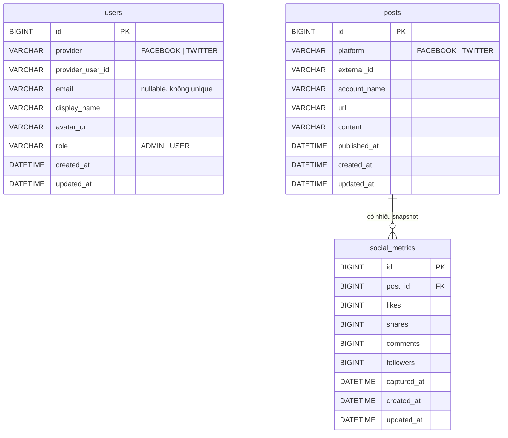

# Thiết kế cơ sở dữ liệu

Phạm vi: issue #3 (P1-02). Schema tạo bằng Flyway: `src/main/resources/db/migration/V1__init_schema.sql`. Hibernate chỉ `validate`, không tự sửa schema ở bất kỳ profile nào.

## Sơ đồ

## Bảng

### `users`

Người đăng nhập bằng Facebook/Twitter (OAuth2, làm ở #9).

| Cột | Kiểu | Ràng buộc | Ghi chú |
|---|---|---|---|
| `provider` | VARCHAR(20) | NOT NULL, CHECK `FACEBOOK`/`TWITTER`, collation `utf8mb4_0900_bin` | enum `SocialPlatform` |
| `provider_user_id` | VARCHAR(100) | NOT NULL | id tài khoản phía provider |
| `email` | VARCHAR(255) | NULL | không unique, xem quyết định bên dưới |
| `display_name` | VARCHAR(100) | NOT NULL | |
| `avatar_url` | VARCHAR(1000) | NULL | |
| `role` | VARCHAR(20) | NOT NULL, mặc định `USER`, CHECK `ADMIN`/`USER`, collation `utf8mb4_0900_bin` | enum `UserRole` |

- UNIQUE `uk_users_provider_user (provider, provider_user_id)`: một tài khoản mạng xã hội chỉ ứng với một user; login lần sau tìm theo cặp này.
- Access token của provider để #9 thêm bằng migration mới (V2), không làm ở đây.

### `posts`

Bài viết cần theo dõi, nhập tay qua API (#4) hoặc import Excel (#6).

| Cột | Kiểu | Ràng buộc | Ghi chú |
|---|---|---|---|
| `platform` | VARCHAR(20) | NOT NULL, CHECK `FACEBOOK`/`TWITTER`, collation `utf8mb4_0900_bin` | enum `SocialPlatform` |
| `external_id` | VARCHAR(100) | NOT NULL | id bài viết trên nền tảng |
| `account_name` | VARCHAR(100) | NOT NULL | page/handle đăng bài; job #10 gom bài theo tài khoản |
| `url` | VARCHAR(1000) | NULL | |
| `content` | VARCHAR(5000) | NULL | DTO ở #4 giới hạn `@Size(max = 5000)` tương ứng |
| `published_at` | DATETIME(6) | NULL | |

- UNIQUE `uk_posts_platform_external_id (platform, external_id)`: khóa nghiệp vụ, dùng để nhận ra bài trùng khi import.
- INDEX `idx_posts_platform_account (platform, account_name)`: job cập nhật metrics lấy bài theo tài khoản.

### `social_metrics`

Snapshot số tương tác của một bài tại thời điểm `captured_at`. Mỗi lần job chạy (mỗi giờ) thêm một dòng, nhờ đó vẽ được biểu đồ theo thời gian (#13, #14).

| Cột | Kiểu | Ràng buộc | Ghi chú |
|---|---|---|---|
| `post_id` | BIGINT | NOT NULL, FK → `posts.id` `ON DELETE CASCADE` | |
| `likes`, `shares`, `comments`, `followers` | BIGINT | NOT NULL, mặc định 0, CHECK `>= 0` | |
| `captured_at` | DATETIME(6) | NOT NULL | thời điểm đo |

- UNIQUE `uk_social_metrics_post_captured (post_id, captured_at)`: không có hai snapshot cùng lúc cho một bài; index này cũng phục vụ FK và truy vấn "snapshot mới nhất của bài".
- INDEX `idx_social_metrics_captured_at (captured_at)`: lọc theo khoảng thời gian cho `/chart-data` và báo cáo.

Mọi bảng có `id` (BIGINT AUTO_INCREMENT), `created_at`, `updated_at` (DATETIME(6), NOT NULL).

## Quyết định thiết kế

1. **Giá trị cố định dùng enum, lưu theo tên (VARCHAR + CHECK) thay vì kiểu `ENUM` của MySQL.** Entity dùng `@Enumerated(STRING)` kèm `@JdbcTypeCode(SqlTypes.VARCHAR)` để khai báo rõ kiểu cột khớp với migration, không phụ thuộc vào kiểu mặc định Hibernate chọn cho enum trên MySQL. Thêm giá trị mới chỉ cần sửa CHECK bằng migration, không phải `ALTER` kiểu cột. Các cột này dùng collation nhị phân `utf8mb4_0900_bin`: với collation mặc định của bảng, `CHECK (platform IN ('FACEBOOK', 'TWITTER'))` cho qua cả `'facebook'`, trong khi Hibernate đọc enum bằng `Enum.valueOf` có phân biệt hoa thường nên sẽ lỗi khi đọc dòng đó. Collation nhị phân giúp CHECK chặn đúng những giá trị Hibernate không đọc được.
2. **`followers` nằm trong `social_metrics`.** Đề chỉ yêu cầu 3 entity `User`, `Post`, `SocialMetric` và nêu followers cùng nhóm với likes/shares. Mỗi snapshot lưu số follower của tài khoản đăng bài tại thời điểm đo, nên các bài cùng tài khoản đo cùng lúc sẽ lặp lại cùng một số. Khi tổng hợp followers theo tài khoản phải lấy một giá trị cho mỗi `(platform, account_name, captured_at)` (ví dụ `MAX`), không được cộng dồn theo bài. Nếu sau này cần lịch sử follower độc lập với bài viết thì tách bảng `social_accounts` bằng migration mới.
3. **`Post` không map `@OneToMany` tới metrics.** Một bài có thể tích lũy hàng nghìn snapshot (mỗi giờ một dòng); đọc qua `SocialMetricRepository` theo khoảng thời gian/phân trang. Không có `orphanRemoval`/`cascade` phía JPA nên thay đổi trên `Post` không thể vô tình xóa snapshot. Xóa bài thì DB tự xóa snapshot (`ON DELETE CASCADE`), vì snapshot không có ý nghĩa khi không còn bài.
4. **`email` không unique.** Twitter có thể không trả email, và một người có thể đăng nhập bằng cả Facebook lẫn Twitter với cùng email; mỗi tài khoản là một user riêng. Gộp tài khoản nằm ngoài phạm vi đề.
5. **Thời gian lưu UTC, "hôm nay" theo `Asia/Ho_Chi_Minh`.** JDBC ghi/đọc theo UTC (`hibernate.jdbc.time_zone=UTC`, `serverTimezone=UTC`). Bean `Clock` dùng múi giờ `app.time-zone` (mặc định `Asia/Ho_Chi_Minh`); code cần ngày hiện tại dùng `LocalDate.now(clock)`, không dùng múi giờ của JVM (UTC trong container). `created_at`/`updated_at` do Spring Data auditing điền từ cùng `Clock`, nên test cố định được thời gian.
6. **Seed dữ liệu chỉ ở profile `dev`.** `DataSeeder` (`@Profile("dev")`) thêm 4 bài mẫu và 7 ngày snapshot, bỏ qua nếu bảng `posts` đã có dữ liệu.

## Lưu ý cho các issue sau

- **Vi phạm UNIQUE, FK hay CHECK đều thành `DataIntegrityViolationException`** (Hibernate 7, test trong `PostRepositoryTests`/`SocialMetricRepositoryTests`). Handler ở #4 map lỗi này về 409, nhưng 409 chỉ đúng cho trường hợp trùng dữ liệu; số âm hay platform không hợp lệ là lỗi input, nên DTO ở #4/#6 phải chặn trước bằng validation (`@PositiveOrZero`, kiểu enum) để trả 422. CHECK chỉ là lớp bảo vệ cuối.
- **Collation `utf8mb4_0900_ai_ci`** (trừ các cột enum ở trên) không phân biệt hoa/thường và dấu: so sánh `account_name` hay tìm kiếm `content` sẽ coi `Thai` và `Thái` là bằng nhau.
