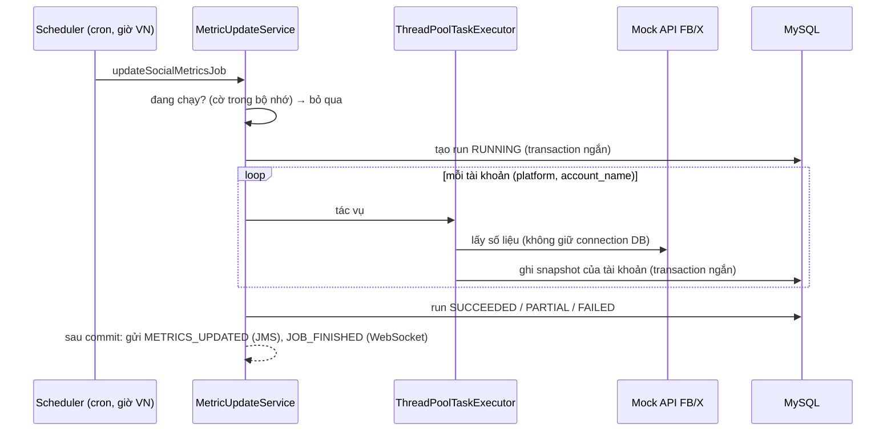

# Kiến trúc

Bảng và API nằm ở [01-thiet-ke-csdl.md](01-thiet-ke-csdl.md) và [02-thiet-ke-api.md](02-thiet-ke-api.md). File này mô tả cách chia code, các luồng chạy nền và lý do. Phần nào chưa làm thì ghi issue dự kiến; cấu hình cụ thể của thư viện bên ngoài (Spring Security 7, Artemis, springdoc, API Facebook/X) ghi "kiểm tra khi làm #N" vì chưa thử trên phiên bản đang dùng.

## 1. Sơ đồ package

Gốc `com.sunasterisk.socialanalytics`. **Đã có** là code trong PR #1, #19, #20; còn lại là dự kiến.

```
com.sunasterisk.socialanalytics
├── SocialAnalyticsApplication                          (đã có)
├── config       ClockConfig, JpaAuditingConfig, OpenApiConfig            (đã có)
│                AsyncConfig (#10: @EnableAsync, 2 executor), JmsConfig (#12), WebSocketConfig (#13), WebServiceConfig (#15)
├── security     SecurityConfig, SocialOAuth2UserService, AdminAccountsProperties,
│                ProblemDetailAuthenticationEntryPoint, ProblemDetailAccessDeniedHandler   (#8, #9)
├── controller   PostController, SocialMetricController                   (đã có)
│                ImportController (#6), ReportController (#7), JobController (#11), ChartDataController (#13)
├── web          LoginController, DashboardController (Thymeleaf)         (#9, #11)
├── service      PostService, SocialMetricService                         (đã có)
│                PostImportService (#6), ReportService (#7), MetricUpdateService (#10),
│                StatsService (#12), ChartDataService (#13), ExchangeRateService (#15)
├── job          UpdateSocialMetricsJob (@Scheduled), JobLauncher (@Async), AccountMetricsUpdater (@Async)   (#10)
├── client       SocialMetricsClient + MockFacebookMetricsClient, MockTwitterMetricsClient   (#10)
├── messaging    StatsRefreshMessage, StatsRefreshPublisher, StatsRefreshListener, DeadLetterListener   (#12)
├── websocket    DashboardEventPublisher                                  (#13)
├── soap         ExchangeRateEndpoint, ExchangeRateClient (class JAXB sinh từ XSD lúc build)   (#15)
├── excel        @ExcelColumn, ExcelReader, ExcelWriter (Reflection)      (#6, #7; tổng quát hóa ở #16)
├── repository   UserRepository, PostRepository, SocialMetricRepository   (đã có)
│                ImportBatchRepository (#6), MetricUpdateRunRepository (#10), DailyPlatformStatsRepository (#12)
├── entity       User, Post, SocialMetric, SocialPlatform, UserRole, BaseEntity   (đã có)
│                ImportBatch (#6), MetricUpdateRun, RunTrigger, RunStatus (#10), DailyPlatformStats (#12)
├── dto          request/response, PageQuery, PageResponse                (đã có, thêm dần)
├── exception    ResourceNotFoundException, ConflictException, GlobalExceptionHandler   (đã có)
├── seed         DataSeeder (@Profile("dev"))                             (đã có)
└── util         LikePatterns, DbTime                                     (đã có)

src/main/resources
├── db/migration       V1__init_schema.sql (đã có), migration mới ở từng issue
├── templates          login, dashboard (Thymeleaf)                       (#9, #11)
├── static/js          dashboard.js: Chart.js, SockJS + STOMP, gọi API kèm CSRF header   (#14)
└── xsd                exchange-rates.xsd                                 (#15)
```

- `controller` là REST (JSON), `web` là trang Thymeleaf: hai loại có cách xử lý lỗi khác nhau (JSON so với chuyển trang), nên tách package để `GlobalExceptionHandler` chỉ áp dụng cho REST (`@RestControllerAdvice` giới hạn theo package hoặc annotation, làm ở #11).
- `client` là ranh giới với "API Facebook/X". Đề chỉ cần bản mock; thay bằng client thật chỉ phải thêm một implementation.

## 2. Trách nhiệm từng lớp

| Lớp | Làm gì | Không làm gì |
|---|---|---|
| controller / web | Nhận request, `@Valid` DTO, gọi service, trả DTO hoặc view | Không truy vấn DB, không chứa nghiệp vụ |
| service | Nghiệp vụ, transaction (`@Transactional`), đổi entity sang DTO trong transaction (`open-in-view` tắt) | Không phụ thuộc tầng web |
| repository | Spring Data JPA, `@Query`, khóa dòng (`@Lock`), câu `DELETE`/`INSERT … SELECT` | |
| job / messaging / websocket | Điểm vào không qua HTTP: lịch chạy, nhận message, phát event; gọi service | Không chứa nghiệp vụ |
| client / soap | Gọi hệ thống bên ngoài (giả lập), timeout và lỗi được đổi thành exception của app | Không giữ transaction khi chờ |

## 3. Bảo mật (#8, #9)

Đăng nhập chỉ bằng OAuth2 (Facebook, X), lưu session; CSRF bật (**đề yêu cầu**). Đề xuất các `SecurityFilterChain`:

| Chain | Áp dụng | Xác thực / phân quyền | CSRF | Khi lỗi |
|---|---|---|---|---|
| API | `/api/**` | Session sau OAuth2 Login; quyền theo bảng ở `02-thiet-ke-api.md` | Bật, xem "Nguồn CSRF token" bên dưới | 401/403 JSON (`ProblemDetail` + `code`) |
| SOAP | `/soap/**` | `permitAll` (dịch vụ giả lập, chỉ đọc) | Tắt (không dùng cookie/session) | |
| Web + còn lại | mọi path khác | `permitAll`: `/login`, `/oauth2/**`, `/login/oauth2/**`, `/css/**`, `/js/**`, `/actuator/health`, `/error`, Swagger (`/swagger-ui/**`, `/v3/api-docs/**`, chỉ khi profile `dev` bật springdoc). Cần đăng nhập: `/`, `/dashboard`, `/ws/**`. **`denyAll` mọi path còn lại** | Bật | Chuyển về `/login` |

- Chain cuối không có `securityMatcher` và có `denyAll` để path không ai khai báo không bị mở ngầm (reviewer repo cũ đã nhắc).
- **Role** (đã chốt, Q1): `SocialOAuth2UserService` lưu/cập nhật `users` theo `(provider, provider_user_id)` mỗi lần login, gán `ROLE_ADMIN` nếu tài khoản có trong `APP_ADMIN_ACCOUNTS`, còn lại `ROLE_USER`. API ghi dữ liệu dùng `hasRole('ADMIN')`.
- **Thông tin user từ provider**: Facebook trả user ở dạng phẳng; X (API v2) bọc user trong trường `data`, nên cần đổi lại trước khi đọc id/tên. Endpoint, scope và việc X yêu cầu PKCE: **kiểm tra khi làm #9**.
- **Token**: lưu qua `JdbcOAuth2AuthorizedClientService` (bảng `oauth2_authorized_client`); không log, không trả ra API (Q8 về mã hóa).
- **Nguồn CSRF token** (**đề yêu cầu** "CSRF token và form submission"). Từ Spring Security 6, token đưa ra trang mặc định được "mask" (mỗi lần một giá trị khác, chống tấn công BREACH, `XorCsrfTokenRequestAttributeHandler`). Mỗi loại client lấy token ở một chỗ:
  - **Form Thymeleaf** (submit thường): trường ẩn `_csrf` do Thymeleaf tự chèn. Có ít nhất hai form thật: đăng xuất (`POST /logout`) và nút "Chạy job ngay" (`POST /dashboard/update-metrics`, issue #11).
  - **JS gọi API** (`fetch` từ dashboard, Swagger UI): đọc cookie `XSRF-TOKEN` (`CookieCsrfTokenRepository`, không `HttpOnly`) và gửi lại trong header. Cookie chứa token chưa mask, nên phía server phải dùng handler cho client JS: Spring Security 7.1 có `csrf.spa()` (đã thấy trong jar 7.1.1), nhận token dạng thô ở header và dạng mask ở tham số form. Tên header (mặc định của cookie repository là `X-XSRF-TOKEN`) và thuộc tính để Swagger UI tự gửi header: **kiểm tra khi làm #8**.
  - **STOMP `CONNECT`**: token lấy từ thẻ meta do Thymeleaf render (giá trị đã mask), gửi trong header của frame `CONNECT`. Interceptor CSRF cho WebSocket của Spring Security 7 cần dạng nào: **kiểm tra khi làm #13**.
- **Upload multipart và CSRF**: form import gửi bằng `fetch` kèm header CSRF như mọi lời gọi API. Không dùng `_csrf` trong body multipart, vì Spring Security chỉ đọc được tham số đó nếu multipart được parse trước filter bảo mật.
- **WebSocket**: handshake `/ws/**` đi qua chain web (cần đăng nhập); frame `CONNECT` kiểm tra CSRF như trên.
- **Login khi dev/demo** (đã chốt, Q2): profile `dev` thêm form login với tài khoản demo đọc từ `.env`; không có ở profile khác.
- `GlobalExceptionHandler` hiện có handler `Exception` chung: phải thêm handler cho `AccessDeniedException`/`AuthenticationException` trả 403/401 cùng format, nếu không chúng thành 500 (đã ghi ở `02-thiet-ke-api.md`).

## 4. Job cập nhật số liệu và đa luồng (#10)



- **Lịch chạy**: `@Scheduled(cron = "${app.metrics-job.cron}", zone = "${app.time-zone}")`, mặc định mỗi giờ (**đề yêu cầu** "mỗi 1 giờ"). Chạy thủ công (#11) gọi cùng service.
- **Thread pool**: `ThreadPoolTaskExecutor` riêng cho job, kích thước (core, max, queue) đọc từ `@ConfigurationProperties` có `@Validated` (`@Min`, `@Max`), sai thì app không khởi động. Mặc định đề xuất 4 luồng: mỗi tác vụ chỉ giữ connection DB trong lúc ghi, nhưng tổng số luồng ghi đồng thời vẫn phải nhỏ hơn pool Hikari (mặc định 10) để còn connection cho request web.
- **Không giữ transaction khi gọi API**: gọi mock API (có độ trễ) ngoài transaction; chỉ mở transaction ngắn để ghi. Giữ transaction trong lúc chờ sẽ chiếm connection và làm cạn pool (reviewer repo cũ đã nhắc ở trường hợp tương tự).
- **`@Async` dùng ở đâu** (**đề yêu cầu** `@Async`, `@EnableAsync`). `@EnableAsync` ở `AsyncConfig`, khai báo hai executor:
  - `metricsAccountExecutor`: chạy tác vụ của từng tài khoản. `AccountMetricsUpdater.update(runId, account)` có `@Async("metricsAccountExecutor")`, trả `CompletableFuture<AccountResult>`; `MetricUpdateService` gọi cho mọi tài khoản rồi chờ `CompletableFuture.allOf(...)` (có timeout) trước khi chốt run.
  - `jobLauncherExecutor` (1 luồng): chạy tay. `JobLauncher.launch(runId)` có `@Async("jobLauncherExecutor")`, trả `void`, nên HTTP trả 202 ngay. Exception thoát khỏi phương thức `void` này không có ai nhận, nên cấu hình `AsyncUncaughtExceptionHandler` để log (**issue #10**).
  - Luồng chờ (`allOf`) không nằm trong pool chạy tác vụ: nếu cùng một pool, pool đầy thì luồng chờ chiếm chỗ của chính các tác vụ nó đang chờ.
  - Phương thức `@Async` phải ở bean khác với nơi gọi: gọi trong cùng class không đi qua proxy nên chạy đồng bộ.
- **Lỗi một tài khoản**: tác vụ bắt exception, log kèm `platform`, `account_name`, `runId`, trả kết quả lỗi để đếm vào `accounts_failed`; các tài khoản khác chạy tiếp.
- **Không chạy chồng**: cờ `AtomicBoolean` trong bộ nhớ (một instance). Lần định kỳ gặp cờ đang bật thì log và bỏ qua; chạy tay thì trả 409. Khởi động lại app: dòng `RUNNING` cũ được đánh dấu `FAILED`.
- **`captured_at`**: mọi snapshot của lần chạy dùng `started_at` của run (xem `01-thiet-ke-csdl.md`). Hai lần chạy khác nhau không trùng thời điểm nên không vi phạm `UNIQUE (post_id, captured_at)`.
- **Test**: client mock trả số cố định, `Clock.fixed`; test riêng trường hợp một tài khoản lỗi, và chạy tay khi job đang chạy (409).

## 5. JMS: thống kê tổng hợp (#12)

- **Broker**: ActiveMQ Artemis (đề xuất, Q10) trong `docker-compose.yml`; test dùng Testcontainers.
- **Queue** `analytics.stats-refresh`. Message JSON `{type, dates, batchId?, runId?}`:
  - `IMPORT_COMPLETED` (**đề yêu cầu**) sau import, `batchId`;
  - `METRICS_UPDATED` sau mỗi lần chạy job, `runId` (đề xuất, Q5);
  - `METRICS_CHANGED` sau khi sửa/xóa bài hoặc snapshot qua API (đề xuất, Q5).
- **Chỉ gửi sau khi commit**: service phát Spring event trong transaction; `@TransactionalEventListener(phase = AFTER_COMMIT)` mới gửi JMS. Rollback thì không gửi. Đánh đổi: app chết đúng lúc giữa commit và gửi thì mất message; lần chạy job kế tiếp tính lại ngày hôm nay nên số liệu tự khớp lại. Transactional outbox nằm ngoài phạm vi.
- **Listener**: tính lại `daily_platform_stats` cho các ngày trong message (xóa + `INSERT … SELECT` trong một transaction, xem `01-thiet-ke-csdl.md`), điền `import_batches.stats_refreshed_at` nếu có `batchId`, rồi gửi WebSocket `STATS_UPDATED`. Chạy một luồng. Tính lại từ dữ liệu gốc nên nhận trùng message vẫn đúng (**issue #12** yêu cầu idempotent).
- **Retry và DLQ** (**đề yêu cầu**): session có transaction; listener ném exception thì broker giao lại, tối đa vài lần có độ trễ, sau đó chuyển sang dead letter queue. Cấu hình số lần và độ trễ ở broker (address settings của Artemis), **kiểm tra khi làm #12**. Một listener trên DLQ log `ERROR` kèm nội dung message để biết message nào bị bỏ.
- Message chỉ chứa id và ngày, không chứa dữ liệu bài viết hay token.

## 6. WebSocket và biểu đồ (#13, #14)

- STOMP qua SockJS ở `/ws`, simple broker `/topic` (một instance, xem mục 9).
- `DashboardEventPublisher` dùng `SimpMessagingTemplate` gửi `STATS_UPDATED` (sau khi listener tính lại thống kê) và `JOB_FINISHED` (sau khi job xong) lên `/topic/metrics`.
- Event không mang số liệu; trang gọi lại `/api/v1/chart-data` rồi cập nhật Chart.js mà không tải lại trang, tự kết nối lại khi mất kết nối (**issue #14**).
- Thư viện JS (Chart.js, SockJS, STOMP) ghim phiên bản cụ thể.

## 7. SOAP (#15)

- Endpoint giả lập tỷ giá viết bằng Spring-WS từ XSD (`src/main/resources/xsd/exchange-rates.xsd`), class sinh bằng JAXB lúc build; phục vụ ở `/soap/*` (không dùng `/ws` vì đã dành cho WebSocket).
- `ExchangeRateClient` dùng `WebServiceTemplate`, URL và timeout từ cấu hình (`APP_EXCHANGE_RATE_URL`, mặc định trỏ vào chính app). SOAP fault/timeout đổi thành exception của app; dashboard hiện "không lấy được tỷ giá" thay vì lỗi cả trang.
- Kết quả dùng ở đâu: Q7.

## 8. Excel và Reflection (#6, #7, #16)

- `@ExcelColumn(name = "platform", required = true)` đặt trên field của class dòng import/export; `ExcelReader`/`ExcelWriter` đọc annotation bằng Reflection, map ô ↔ field theo tên cột, đổi kiểu (chuỗi, số, ngày, enum). Không viết tay từng cột (**issue #6**).
- Metadata (field, setter/getter, kiểu) đọc một lần mỗi class rồi cache (**issue #16**).
- Import đọc cả file, kiểm tra từng dòng (Bean Validation trên class dòng), gom lỗi theo số dòng Excel trước khi ghi DB.
- Export dùng `SXSSFWorkbook` (giữ một số dòng trong bộ nhớ, phần còn lại ghi ra file tạm) (**issue #7**).
- #16 gom phần dùng chung thành một importer/exporter cho mọi class có `@ExcelColumn`.

## 9. Triển khai và cấu hình

- Docker Compose: `mysql` (đã có), thêm `artemis` (#12) và `app` (`Dockerfile`, #17).
- Biến môi trường mới (thêm vào `.env.example` ở từng issue): `FACEBOOK_CLIENT_ID`, `FACEBOOK_CLIENT_SECRET`, `TWITTER_CLIENT_ID`, `TWITTER_CLIENT_SECRET`, `APP_ADMIN_ACCOUNTS` (#9); `METRICS_JOB_CRON`, kích thước thread pool (#10); `ARTEMIS_*` (#12); `APP_EXCHANGE_RATE_URL` (#15). Giá trị bí mật không commit.
- **Một instance**: session đăng nhập, cờ chống chạy chồng job và broker WebSocket đều trong bộ nhớ. Chạy nhiều instance cần: Spring Session (JDBC/Redis), khóa phân tán cho job (ví dụ ShedLock), broker STOMP ngoài. Ngoài phạm vi đề, ghi lại để biết giới hạn.

## 10. Quy ước đã áp dụng từ #2–#4 (giữ cho các issue sau)

- Thời gian: lưu UTC `DATETIME(6)`, cắt về micro giây (`DbTime`); "hôm nay" và ranh giới ngày qua bean `Clock` (`Asia/Ho_Chi_Minh`).
- Lỗi: `ProblemDetail` + `code`, `GlobalExceptionHandler` kế thừa `ResponseEntityExceptionHandler`; 409 cho lỗi ràng buộc kèm `log.warn`.
- Ghi đồng thời: sửa thì khóa dòng ngay lần đọc đầu, xóa bằng một câu `DELETE` kiểm tra số dòng; có test hai luồng.
- Tìm kiếm `LIKE` escape `%`, `_` (`LikePatterns`).
- Seed dữ liệu chỉ ở profile `dev`; Swagger chỉ ở profile `dev`.
- Test chạy trên MySQL thật (Testcontainers), không phụ thuộc thứ tự, nhánh xử lý lỗi đều có test.
