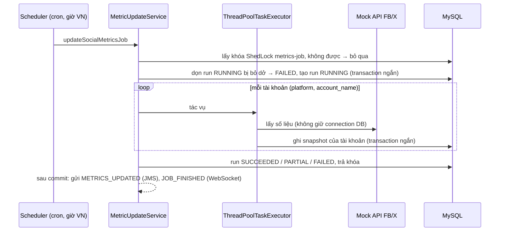

# Kiến trúc

Bảng và API nằm ở [01-thiet-ke-csdl.md](01-thiet-ke-csdl.md) và [02-thiet-ke-api.md](02-thiet-ke-api.md). File này mô tả cách chia code, các luồng chạy nền và lý do. Phần nào chưa làm thì ghi issue dự kiến; cấu hình cụ thể của thư viện bên ngoài (Spring Security 7, Artemis, springdoc, API Facebook/X) ghi "kiểm tra khi làm #N" vì chưa thử trên phiên bản đang dùng.

## 1. Sơ đồ package

Gốc `com.sunasterisk.socialanalytics`. **Đã có** là code trong PR #1, #19, #20; còn lại là dự kiến.

```
com.sunasterisk.socialanalytics
├── SocialAnalyticsApplication                          (đã có)
├── config       ClockConfig, JpaAuditingConfig, OpenApiConfig            (đã có)
│                AsyncConfig (#10: @EnableAsync, 2 executor), JmsConfig (#12), WebSocketConfig (#13), WebServiceConfig (#15)
├── security     SecurityConfig, DemoLoginProperties, HeaderCsrfTokenRequestHandler   (#8)
│                SocialOAuth2UserService, AdminAccountsProperties                          (#9)
├── controller   PostController, SocialMetricController                   (đã có)
│                ImportController (#6), ReportController (#7), JobController (#11), ChartDataController (#13)
├── web          LoginController, DashboardController (Thymeleaf)         (#9, #11)
├── service      PostService, SocialMetricService                         (đã có)
│                PostImportService (#6), ReportService (#7),
│                StatsService (#12), ChartDataService (#13), ExchangeRateService (#15)
│   └── metrics  MetricUpdateService, AccountMetricsUpdater (@Async), JobLauncher (@Async)   (#10)
├── job          UpdateSocialMetricsJob (@Scheduled), chỉ gọi MetricUpdateService   (#10)
├── client       SocialMetricsClient + MockFacebookMetricsClient, MockTwitterMetricsClient   (#10)
├── messaging    StatsRefreshMessage, StatsRefreshPublisher, StatsRefreshListener, DeadLetterListener   (#12)
├── websocket    DashboardEventPublisher                                  (#13)
├── soap         ExchangeRateEndpoint, ExchangeRateClient (class JAXB sinh từ XSD lúc build)   (#15)
├── excel        @ExcelColumn, ExcelReader, ExcelWriter (Reflection)      (#6, #7; tổng quát hóa ở #16)
├── repository   UserRepository, PostRepository, SocialMetricRepository   (đã có)
│                ImportBatchRepository (#6), MetricUpdateRunRepository (#10), DailyPlatformStatsRepository (#12)
├── entity       User, Post, SocialMetric, SocialPlatform, UserRole, BaseEntity   (đã có)
│                ImportBatch (#6), MetricUpdateRun, RunTrigger, RunStatus (#10), DailyPlatformStats (#12)
├── dto          request/response, PageQuery, PageResponse                (đã có, thêm dần)
├── exception    ResourceNotFoundException, ConflictException, GlobalExceptionHandler   (đã có)
├── seed         DataSeeder (@Profile("dev"))                             (đã có)
└── util         LikePatterns, DbTime                                     (đã có)

src/main/resources
├── db/migration       V1__init_schema.sql (đã có), migration mới ở từng issue
├── templates          login, dashboard (Thymeleaf)                       (#9, #11)
├── static/js          dashboard.js: Chart.js, SockJS + STOMP, gọi API kèm CSRF header   (#14)
└── xsd                exchange-rates.xsd                                 (#15)
```

- `controller` là REST (JSON), `web` là trang Thymeleaf: hai loại có cách xử lý lỗi khác nhau (JSON so với chuyển trang), nên tách package để `GlobalExceptionHandler` chỉ áp dụng cho REST (`@RestControllerAdvice` giới hạn theo package hoặc annotation, làm ở #11).
- `client` là ranh giới với "API Facebook/X". Đề chỉ cần bản mock; thay bằng client thật chỉ phải thêm một implementation. Bản mock trả số tăng dần ngẫu nhiên, độ trễ và tỷ lệ lỗi cấu hình được (đã chốt, Q6).
- **Phụ thuộc chỉ đi một chiều** `controller`/`web`/`job`/`messaging` → `service` → `repository`/`client`; không gói nào import `job`. Vì vậy mọi phần của luồng cập nhật số liệu mà service gọi tới (`AccountMetricsUpdater` do `MetricUpdateService` gọi, `JobLauncher` do luồng chạy tay từ HTTP gọi) nằm trong `service.metrics`, còn `job` chỉ có `UpdateSocialMetricsJob` là điểm vào theo lịch. Nếu để hai class đó ở `job` thì `job` và `service` import lẫn nhau, sửa bên này phải kiểm lại bên kia.

## 2. Trách nhiệm từng lớp

| Lớp | Làm gì | Không làm gì |
|---|---|---|
| controller / web | Nhận request, `@Valid` DTO, gọi service, trả DTO hoặc view | Không truy vấn DB, không chứa nghiệp vụ |
| service | Nghiệp vụ, transaction (`@Transactional`), đổi entity sang DTO trong transaction (`open-in-view` tắt) | Không phụ thuộc tầng web |
| repository | Spring Data JPA, `@Query`, khóa dòng (`@Lock`), câu `DELETE`/`INSERT … SELECT` | |
| job / messaging / websocket | Điểm vào không qua HTTP: lịch chạy, nhận message, phát event; gọi service | Không chứa nghiệp vụ |
| client / soap | Gọi hệ thống bên ngoài (giả lập), timeout và lỗi được đổi thành exception của app | Không giữ transaction khi chờ |

## 3. Bảo mật (#8, #9)

Đăng nhập chỉ bằng OAuth2 (Facebook, X), lưu session trên MySQL (Spring Session JDBC, xem dưới); CSRF bật (**đề yêu cầu**). Đề xuất các `SecurityFilterChain`:

| Chain | Áp dụng | Xác thực / phân quyền | CSRF | Khi lỗi |
|---|---|---|---|---|
| API | `/api/**` | Session sau OAuth2 Login; quyền theo bảng ở `02-thiet-ke-api.md` | Bật, xem "Nguồn CSRF token" bên dưới | 401/403 JSON (`ProblemDetail` + `code`) |
| SOAP | `/soap/**` | `permitAll` (dịch vụ giả lập, chỉ đọc) | Tắt (không dùng cookie/session) | |
| Web + còn lại | mọi path khác | `permitAll`: `/login`, `/oauth2/**`, `/login/oauth2/**`, `/css/**`, `/js/**`, `/actuator/health`, `/error`, Swagger (`/swagger-ui/**`, `/v3/api-docs/**`, chỉ khi profile `dev` bật springdoc). Cần đăng nhập: `/`, `/dashboard`, `/ws/**`. **`denyAll` mọi path còn lại** | Bật, trừ `/ws/**` (xem "WebSocket" bên dưới) | Chuyển về `/login` |

- Chain cuối không có `securityMatcher` và có `denyAll` để path không ai khai báo không bị mở ngầm (reviewer repo cũ đã nhắc).
- **Role** (đã chốt, Q1): `SocialOAuth2UserService` lưu/cập nhật `users` theo `(provider, provider_user_id)` mỗi lần login, gán `ROLE_ADMIN` nếu tài khoản có trong `APP_ADMIN_ACCOUNTS`, còn lại `ROLE_USER`. API ghi dữ liệu dùng `hasRole('ADMIN')`.
- **Thông tin user từ provider**: Facebook trả user ở dạng phẳng; X (API v2) bọc user trong trường `data`, nên cần đổi lại trước khi đọc id/tên. Endpoint, scope và việc X yêu cầu PKCE: **kiểm tra khi làm #9**.
- **Session**: `spring-boot-starter-session-jdbc`, bảng `SPRING_SESSION*` tạo bằng migration (`01-thiet-ke-csdl.md`). Session của `oauth2Login`, gồm cả `state` của lượt chuyển sang Facebook/X, nằm trên MySQL thay vì bộ nhớ Tomcat, nên restart hay deploy không đăng xuất mọi người, và khi chạy nhiều instance thì lượt quay về từ Facebook/X rơi vào instance nào cũng đọc được `state`. Đánh đổi: cookie đổi tên từ `JSESSIONID` thành `SESSION`, mỗi request có session thêm một SELECT và một UPDATE.
- **Token**: lưu qua `JdbcOAuth2AuthorizedClientService` (bảng `oauth2_authorized_client`); không log, không trả ra API. Mã hóa AES-GCM khi lưu (đã chốt, Q8), khóa từ `APP_TOKEN_ENCRYPTION_KEY`, qua row mapper / parameters mapper của service đó (kiểm tra khi làm #9).
- **Nguồn CSRF token** (**đề yêu cầu** "CSRF token và form submission"). Từ Spring Security 6, token đưa ra trang mặc định được "mask" (mỗi lần một giá trị khác, chống tấn công BREACH, `XorCsrfTokenRequestAttributeHandler`). Mỗi loại client lấy token ở một chỗ:
  - **Form Thymeleaf** (submit thường): trường ẩn `_csrf` do Thymeleaf tự chèn. Có ít nhất hai form thật: đăng xuất (`POST /logout`) và nút "Chạy job ngay" (`POST /dashboard/update-metrics`, issue #11).
  - **JS gọi API** (`fetch` từ dashboard, Swagger UI): đọc cookie `XSRF-TOKEN` (`CookieCsrfTokenRepository`, không `HttpOnly`) và gửi lại trong header `X-XSRF-TOKEN`. Cookie chứa token chưa mask. Đã làm ở #8:
    - Chain API dùng `HeaderCsrfTokenRequestHandler`: chỉ đọc token thô từ header, không đọc tham số `_csrf` (xem "Upload multipart và CSRF").
    - Chain web dùng `csrf.spa()` của Spring Security 7.1: header dạng thô, hoặc trường `_csrf` dạng mask của form.
    - Token mặc định chỉ được tạo khi có ai đọc nó. Cả hai handler đặt tên attribute CSRF là `null` (`csrf.spa()` tự làm; `HeaderCsrfTokenRequestHandler` gọi `setCsrfRequestAttributeName(null)`), nên token được nạp ở mọi request và cookie luôn có, kể cả ngay sau khi đăng nhập (sửa theo review #28, thay cho một filter riêng).
    - Swagger UI tự gửi header nhờ `springdoc.swagger-ui.csrf.enabled=true` (profile `dev`).
  - **STOMP `CONNECT`**: token lấy từ thẻ meta do Thymeleaf render (giá trị đã mask), gửi trong header của frame `CONNECT`. Interceptor CSRF cho WebSocket của Spring Security 7 cần dạng nào: **kiểm tra khi làm #13**.
- **Upload multipart và CSRF**: form import gửi bằng `fetch` kèm header CSRF như mọi lời gọi API. API không đọc `_csrf` trong body multipart: tìm tham số đó buộc Tomcat parse body ngay trong `CsrfFilter`, và body vượt giới hạn upload ném `InvalidParameterException` ở đó, trước mọi handler lỗi (đã đo: log `ERROR` hai lần kèm stack trace cho mỗi request như vậy, ai cũng gửi được). Chỉ đọc header thì thiếu token là 403 sạch, đủ token mà file quá lớn là 413.
- **401/403 của API**: `SecurityConfig` khai báo entry point và access denied handler chuyển exception cho `HandlerExceptionResolver`, nên `GlobalExceptionHandler` trả cùng format lỗi (`UNAUTHORIZED`, `FORBIDDEN`). Quyền chỉ đặt theo URL, không dùng `@PreAuthorize`.
- **WebSocket**: handshake `/ws/**` đi qua chain web (cần đăng nhập); frame `CONNECT` kiểm tra CSRF như trên.
  - Chain web bỏ kiểm tra CSRF ở tầng HTTP **chỉ cho `/ws/**`** (`csrf.ignoringRequestMatchers("/ws/**")`). Khi mạng hay reverse proxy không cho WebSocket, SockJS chuyển sang transport HTTP (XHR, gửi frame bằng POST), mà SockJS không cho gắn header hay tham số CSRF vào các POST đó, nên bật CSRF ở đây thì mọi POST tới `/ws/**` bị 403 và biểu đồ không tự cập nhật. Tài liệu Spring Security (mục "SockJS & Relaxing CSRF") hướng dẫn đúng cách này.
  - Vẫn an toàn vì token CSRF được kiểm ở frame `CONNECT` của STOMP: không có token đúng thì không kết nối được. Mọi URL khác vẫn bật CSRF.
  - Cùng mục đó: `headers.frameOptions(sameOrigin)` để transport iframe của SockJS chạy được (mặc định Spring Security chặn mọi iframe).
- **Login khi dev/demo** (đã chốt, Q2): profile `dev` thêm form login với tài khoản demo đọc từ `.env`; không có ở profile khác. Làm ở #8 (trước #9) để các màn hình sau đăng nhập chạy thử được; tài khoản demo không có dòng trong `users`, nên `uploaded_by` / `triggered_by` để NULL.
- `GlobalExceptionHandler` hiện có handler `Exception` chung: phải thêm handler cho `AccessDeniedException`/`AuthenticationException` trả 403/401 cùng format, nếu không chúng thành 500 (đã ghi ở `02-thiet-ke-api.md`).

## 4. Job cập nhật số liệu và đa luồng (#10)



- **Lịch chạy**: `@Scheduled(cron = "${app.metrics-job.cron}", zone = "${app.time-zone}")`, mặc định mỗi giờ (**đề yêu cầu** "mỗi 1 giờ"). Chạy thủ công (#11) gọi cùng service.
- **Thread pool**: `ThreadPoolTaskExecutor` riêng cho job, kích thước (core, max, queue) đọc từ `@ConfigurationProperties` có `@Validated` (`@Min`, `@Max`), sai thì app không khởi động. Mặc định đề xuất 4 luồng: mỗi tác vụ chỉ giữ connection DB trong lúc ghi, nhưng tổng số luồng ghi đồng thời vẫn phải nhỏ hơn pool Hikari (mặc định 10) để còn connection cho request web.
- **Không giữ transaction khi gọi API**: gọi mock API (có độ trễ) ngoài transaction; chỉ mở transaction ngắn để ghi. Giữ transaction trong lúc chờ sẽ chiếm connection và làm cạn pool (reviewer repo cũ đã nhắc ở trường hợp tương tự).
- **`@Async` dùng ở đâu** (**đề yêu cầu** `@Async`, `@EnableAsync`). `@EnableAsync` ở `AsyncConfig`, khai báo hai executor:
  - `metricsAccountExecutor`: chạy tác vụ của từng tài khoản. `AccountMetricsUpdater.update(runId, account)` có `@Async("metricsAccountExecutor")`, trả `CompletableFuture<AccountResult>`; `MetricUpdateService` gọi cho mọi tài khoản rồi chờ `CompletableFuture.allOf(...)` (có timeout) trước khi chốt run.
  - `jobLauncherExecutor` (1 luồng): chạy tay. `JobLauncher.launch(runId)` có `@Async("jobLauncherExecutor")`, trả `void`, nên HTTP trả 202 ngay. Exception thoát khỏi phương thức `void` này không có ai nhận, nên cấu hình `AsyncUncaughtExceptionHandler` để log (**issue #10**).
  - Luồng chờ (`allOf`) không nằm trong pool chạy tác vụ: nếu cùng một pool, pool đầy thì luồng chờ chiếm chỗ của chính các tác vụ nó đang chờ.
  - Phương thức `@Async` phải ở bean khác với nơi gọi: gọi trong cùng class không đi qua proxy nên chạy đồng bộ.
- **Lỗi một tài khoản**: tác vụ bắt exception, log kèm `platform`, `account_name`, `runId`, trả kết quả lỗi để đếm vào `accounts_failed`; các tài khoản khác chạy tiếp.
- **Không chạy chồng, kể cả khi chạy nhiều instance**: khóa ShedLock tên `metrics-job` trên MySQL sẵn có (`JdbcTemplateLockProvider` với `usingDbTime()`, để các instance so thời gian theo đồng hồ của DB; bảng `shedlock` ở `01-thiet-ke-csdl.md`). Cờ trong bộ nhớ chỉ chặn được trong một instance: hai instance cùng chạy lúc 10:00 sẽ tạo hai snapshot cho mỗi bài và gọi API gấp đôi.
  - Lần định kỳ: `@SchedulerLock(name = "metrics-job")` trên `UpdateSocialMetricsJob` (`@EnableSchedulerLock`); không lấy được khóa thì ShedLock bỏ qua lần đó.
  - Chạy tay (#11): gọi `LockProvider.lock(...)` với cùng tên khóa ngay trong request; không lấy được thì trả 409, lấy được thì chuyển khóa cho `JobLauncher` chạy nền và `unlock()` trong `finally` khi run xong. Nhờ vậy bấm "Chạy job ngay" ở instance nào cũng nhận 409 khi job đang chạy ở instance khác.
  - `lockAtMostFor` dài hơn hạn chờ của `allOf(...)` cộng thời gian chốt run, để khóa không hết hạn khi run còn đang chạy. App chết giữa chừng thì khóa tự hết hạn sau `lockAtMostFor`, lần sau chạy lại được.
  - Dòng `RUNNING` bị bỏ dở được đánh `FAILED` **ngay sau khi lấy được khóa**, không phải lúc khởi động app: lúc giữ khóa thì chắc chắn không instance nào khác đang chạy job, còn lúc khởi động thì instance khác có thể đang chạy và bị đánh nhầm.
  - Dùng ShedLock 7.x (7.11.0): compatibility matrix trong README của ShedLock ghi hỗ trợ Spring 7.0 và Spring Boot 4.x (Boot 4.1.3 dùng Spring Framework 7.0.11). Thêm `shedlock-spring` và `shedlock-provider-jdbc-template`.
- **`captured_at`**: mọi snapshot của lần chạy dùng `started_at` của run (xem `01-thiet-ke-csdl.md`). Hai lần chạy khác nhau không trùng thời điểm nên không vi phạm `UNIQUE (post_id, captured_at)`.
- **Test**: client mock trả số cố định, `Clock.fixed`; test riêng trường hợp một tài khoản lỗi, chạy tay khi đang giữ khóa (409), và dòng `RUNNING` cũ được đánh `FAILED` khi lấy được khóa.

## 5. JMS: thống kê tổng hợp (#12)

- **Broker**: ActiveMQ Artemis (đã chốt, Q10) trong `docker-compose.yml`; test dùng Testcontainers. Artemis đã tách khỏi ActiveMQ thành **Apache Artemis**: client là `org.apache.artemis` 2.53.0 (Boot 4.1.3 quản lý), image `apache/artemis:2.53.0` (image `apache/activemq-artemis` dừng ở 2.44.0).
  - Client không prefetch (`consumerWindowSize=0` trong `broker-url`): consumer đang bận (một lần tính dài) hoặc đã dừng không giữ message trong bộ đệm, message đi tới consumer kế tiếp hỏi. Đã gặp khi test: consumer của context đang "pause" giữ message đã prefetch, message không được xử lý.
- **Queue** `analytics.stats-refresh`. Message JSON `{type, fromDate, batchId?, runId?}`; `fromDate` là ngày sớm nhất bị ảnh hưởng, listener tính lại từ ngày đó tới hôm nay (`01-thiet-ke-csdl.md`):
  - `IMPORT_COMPLETED` (**đề yêu cầu**) sau import, `batchId`;
  - `METRICS_UPDATED` sau mỗi lần chạy job, `runId` (đã chốt, Q5);
  - `METRICS_CHANGED` sau khi sửa/xóa bài hoặc snapshot qua API (đã chốt, Q5).
- **Chỉ gửi sau khi commit**: service phát Spring event trong transaction; `@TransactionalEventListener(phase = AFTER_COMMIT)` mới gửi JMS. Rollback thì không gửi. Đánh đổi: app chết đúng lúc giữa commit và gửi thì mất message; lần chạy job kế tiếp tính lại ngày hôm nay nên message của import/job tự khớp lại; message của một lần sửa dữ liệu cũ qua API bị mất thì các ngày cũ lệch cho tới lần sửa kế tiếp ở khoảng đó. Transactional outbox nằm ngoài phạm vi.
- **Listener**: tính lại `daily_platform_stats` từ `fromDate` tới hôm nay (xóa + `INSERT … SELECT` trong một transaction READ COMMITTED, xem `01-thiet-ke-csdl.md`), điền `import_batches.stats_refreshed_at` nếu có `batchId`, rồi gửi WebSocket `STATS_UPDATED` (#13). Một lần tính lại tại một thời điểm trên mọi instance: queue `exclusive` (broker chỉ giao message cho một consumer, consumer khác chỉ nhận thay khi consumer đó ngắt kết nối), và mỗi instance chỉ có một luồng listener. Không có `exclusive` thì hai instance tính lại cùng một ngày song song sẽ deadlock hoặc trùng khóa chính của `daily_platform_stats` (đã gặp khi test có nhiều consumer).
- **Gửi lỗi**: broker không kết nối được lúc gửi (sau commit) thì log `ERROR`, không ném lỗi cho request đã commit. Message chỉ có id và ngày; kiểu Java đi theo alias `_type` = `stats-refresh` (`JmsConfig`), không theo tên class. Tính lại từ dữ liệu gốc nên nhận trùng message vẫn đúng (**issue #12** yêu cầu idempotent).
- **Retry và DLQ** (**đề yêu cầu**): session có transaction; listener ném exception thì broker giao lại, tối đa vài lần có độ trễ, sau đó chuyển sang dead letter queue. Cấu hình ở broker (`docker/artemis/broker.properties`, chép đè lên cấu hình của image, Docker Compose và test dùng chung): giao lại sau 1, 2, 4 giây, lỗi lần thứ 4 thì chuyển sang `analytics.stats-refresh.dlq`; hai queue được khai báo sẵn để giữ message cả khi chưa app nào kết nối. Một listener trên DLQ log `ERROR` kèm nội dung message để biết message nào bị bỏ.
- Message chỉ chứa id và ngày, không chứa dữ liệu bài viết hay token.

## 6. WebSocket và biểu đồ (#13, #14)

- STOMP qua SockJS ở `/ws`, simple broker `/topic` (một instance, xem mục 9).
- `DashboardEventPublisher` dùng `SimpMessagingTemplate` gửi `STATS_UPDATED` (sau khi listener tính lại thống kê) và `JOB_FINISHED` (sau khi job xong) lên `/topic/metrics`.
- Event không mang số liệu; trang gọi lại `/api/v1/chart-data` rồi cập nhật Chart.js mà không tải lại trang, tự kết nối lại khi mất kết nối (**issue #14**).
- Thư viện JS (Chart.js, SockJS, STOMP) ghim phiên bản cụ thể.

## 7. SOAP (#15)

- Endpoint giả lập tỷ giá viết bằng Spring-WS từ XSD (`src/main/resources/xsd/exchange-rates.xsd`), class sinh bằng JAXB lúc build; phục vụ ở `/soap/*` (không dùng `/ws` vì đã dành cho WebSocket).
- `ExchangeRateClient` dùng `WebServiceTemplate`, URL và timeout từ cấu hình (`APP_EXCHANGE_RATE_URL`, mặc định trỏ vào chính app). SOAP fault/timeout đổi thành exception của app; dashboard hiện "không lấy được tỷ giá" thay vì lỗi cả trang.
- Kết quả dùng ở đâu (đã chốt, Q7 = b + c): dashboard hiện tỷ giá USD → VND và tổng chi phí quảng cáo quy ra VND; file export thêm cột quy đổi và sheet tỷ giá. Tỷ giá cache trong bộ nhớ theo ngày.

## 8. Excel và Reflection (#6, #7, #16)

- `@ExcelColumn(name = "platform", required = true)` đặt trên field của class dòng import/export; `ExcelReader`/`ExcelWriter` đọc annotation bằng Reflection, map ô ↔ field theo tên cột, đổi kiểu (chuỗi, số, ngày, enum). Không viết tay từng cột (**issue #6**).
- Metadata (field, setter/getter, kiểu) đọc một lần mỗi class rồi cache (**issue #16**).
- Import đọc file theo dạng streaming (`excel-streaming-reader`, không nạp cả workbook vào bộ nhớ), kiểm tra từng dòng (Bean Validation trên class dòng), gom lỗi theo số dòng Excel trước khi ghi DB.
- Export dùng `SXSSFWorkbook` (giữ một số dòng trong bộ nhớ, phần còn lại ghi ra file tạm) (**issue #7**). Text bắt đầu như một công thức (`=`, `+`, `-`, `@`, Tab, CR, LF) được ghi với kiểu ô "quote prefix", nên vẫn là text sau khi người dùng sửa ô trong Excel (sửa theo review #27).
- #16 gom phần dùng chung thành một importer/exporter cho mọi class có `@ExcelColumn`.

## 9. Triển khai và cấu hình

- Docker Compose: `mysql` (đã có), thêm `artemis` (#12) và `app` (`Dockerfile`, #17).
- Biến môi trường mới (thêm vào `.env.example` ở từng issue): `FACEBOOK_CLIENT_ID`, `FACEBOOK_CLIENT_SECRET`, `TWITTER_CLIENT_ID`, `TWITTER_CLIENT_SECRET`, `APP_ADMIN_ACCOUNTS` (#9); `METRICS_JOB_CRON`, kích thước thread pool (#10); `ARTEMIS_*` (#12); `APP_EXCHANGE_RATE_URL` (#15). Giá trị bí mật không commit.
- **Một instance cho WebSocket**: broker STOMP là simple broker trong bộ nhớ, event phát ở instance nào chỉ tới client nối vào instance đó. Chạy nhiều instance cần broker STOMP ngoài; ngoài phạm vi đề, ghi lại để biết giới hạn. Session (Spring Session JDBC) và khóa chống chạy chồng job (ShedLock) đã nằm trên MySQL nên không bị giới hạn này.

## 10. Quy ước đã áp dụng từ #2–#4 (giữ cho các issue sau)

- Thời gian: lưu UTC `DATETIME(6)`, cắt về micro giây (`DbTime`); "hôm nay" và ranh giới ngày qua bean `Clock` (`Asia/Ho_Chi_Minh`).
- Cột enum: VARCHAR + CHECK với collation `utf8mb4_0900_bin`, để CHECK phân biệt hoa thường như `Enum.valueOf`.
- Lỗi: `ProblemDetail` + `code`, `GlobalExceptionHandler` kế thừa `ResponseEntityExceptionHandler`; 409 cho lỗi ràng buộc kèm `log.warn`.
- Ghi đồng thời: sửa thì khóa dòng ngay lần đọc đầu và so `updatedAt` client đã đọc (khác thì 409), xóa bằng một câu `DELETE` kiểm tra số dòng; có test hai luồng.
- Tìm kiếm `LIKE` escape `%`, `_` (`LikePatterns`).
- Seed dữ liệu chỉ ở profile `dev`; Swagger chỉ ở profile `dev`.
- Test chạy trên MySQL thật (Testcontainers), không phụ thuộc thứ tự, nhánh xử lý lỗi đều có test.
